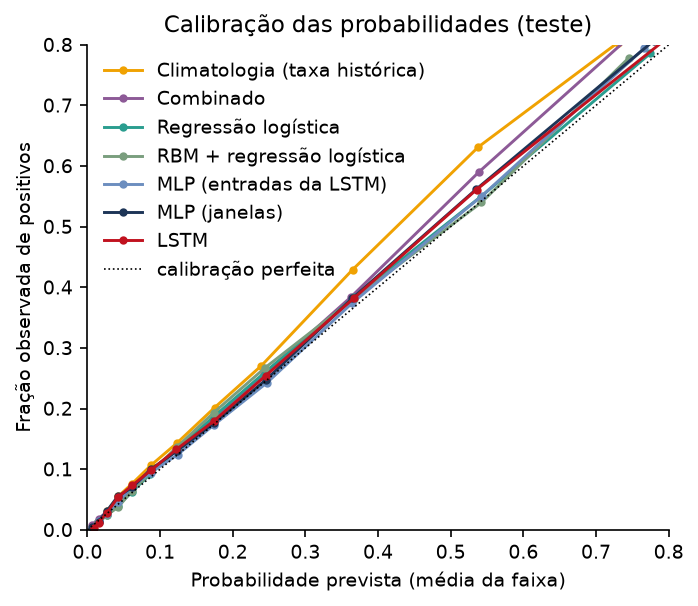
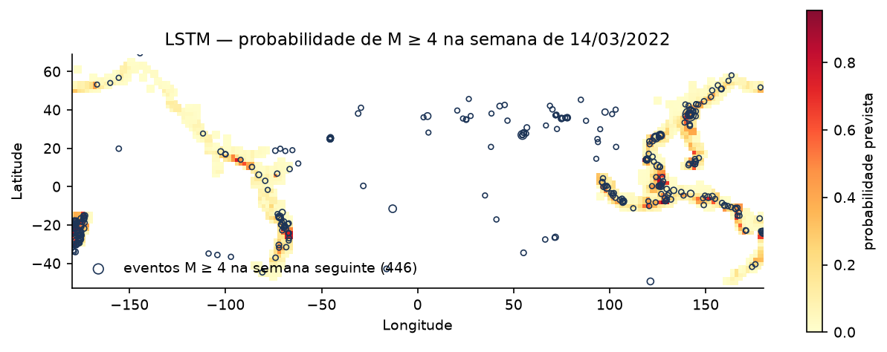

# SeismicAI Pulse: a próxima semana, área por área

**Uma startup acadêmica que transforma o catálogo público de terremotos em um mapa semanal de probabilidades para o Círculo de Fogo do Pacífico**

Alice De Muylder, Valmir Cerutti e Tiago Abreu, Disciplina de Redes Neurais e Deep Learning, 2026.
Código, dados e protótipo: repositório do projeto; site: https://deep-learning-terremoto.web.app

---

## 1. Problema

A sismicidade está longe de ser aleatória. Ela se concentra em regiões conhecidas, como o Círculo de
Fogo do Pacífico, onde ocorrem três de cada quatro terremotos de magnitude 4 ou mais do planeta, e se
agrupa no tempo: um evento grande costuma ser seguido por semanas de réplicas, e a atividade tende a
se espalhar para áreas vizinhas. Ninguém sabe dizer o dia, o lugar exato e a magnitude do próximo
terremoto, mas é possível medir onde a atividade está mais provável.

Hoje, quem precisa lidar com esse risco encontra duas fontes de informação: catálogos de eventos, que
dizem o que já aconteceu, e mapas de risco sísmico, que trabalham na escala de décadas. Falta o meio
do caminho: uma visão simples, de curto prazo e por área, que responda a uma pergunta prática:
**nesta semana, em quais regiões a atenção deve estar?** É uma pergunta relevante para seguradoras e
resseguradoras, que acompanham a exposição de curto prazo das carteiras; para a defesa civil e para
operadores de infraestrutura crítica (portos, usinas, mineração), que precisam priorizar inspeções
e prontidão; e para o jornalismo científico.

## 2. Solução proposta

O SeismicAI Pulse divide o Círculo de Fogo em 709 células de 2° × 2° (cerca de 220 km de lado) e, para
cada uma, estima toda semana a **probabilidade de ocorrer pelo menos um terremoto de magnitude ≥ 4,0
na semana seguinte**. A estimativa vem de uma rede neural treinada com o histórico das 52 semanas
anteriores da célula e de suas oito vizinhas. Uma segunda rede, de Hopfield, resume essa probabilidade
e a atividade recente em um estado de alerta, NORMAL, ATENÇÃO ou ALARME, em que o alarme é
reservado a padrões associados a terremotos de magnitude mais alta (≥ 5,0).

O resultado é publicado em um site com um mapa interativo, atualizado a partir do feed público do
USGS. O produto não prevê terremotos: ele mede, com probabilidades calibradas, onde a atividade
sísmica de curto prazo está mais provável, e diz isso de forma que qualquer pessoa possa ler.

## 3. Dados

A fonte é o catálogo ComCat do United States Geological Survey (USGS), acessado pelo serviço FDSN
Event Web Service. Foram baixados todos os eventos de magnitude ≥ 4,0 registrados no mundo entre
janeiro de 2000 e dezembro de 2025, 358.672 eventos, dos quais 73,8 % dentro das doze caixas que
delimitam o Círculo de Fogo. O período começa em 2000 porque a rede sismográfica global já estava
consolidada; antes disso, muitos eventos de magnitude 4 em áreas remotas simplesmente não eram
registrados, e a rede neural aprenderia uma "queda de atividade" que é só falha de medição.

A preparação seguiu critérios explícitos: apenas registros do tipo *earthquake* (sem explosões ou
erupções), sem duplicatas, sem valores faltantes de tempo, posição, profundidade ou magnitude. Cada
evento foi atribuído a uma célula e a uma semana (segunda a domingo, em UTC). Para cada célula e
semana foram calculadas dez variáveis (número de eventos, magnitude máxima e média, energia sísmica
liberada, profundidade média, eventos de magnitude ≥ 5 e ≥ 6, semanas desde o último evento e a
atividade nas células vizinhas), além de cinco atributos fixos da célula, como sua posição e sua taxa
histórica de atividade. A amostra é o par (célula, semana): 629.592 pares para treino (2001–2017),
111.313 para validação (2018–2020) e 184.340 para teste (2021–2025). A divisão é temporal, e tudo que
o modelo "sabe" sobre uma célula vem exclusivamente do período de treino, o que evita qualquer
vazamento de informação do futuro.

Os picos que aparecem nas séries semanais (59 eventos em uma semana na célula do Mar de Banda, em
novembro de 2023) são sequências de réplicas de terremotos rasos, naquele caso um dubleto M7,1, e não
erros: em 5.914 sequências do catálogo, o número de réplicas é explicado pela magnitude e pela
profundidade do evento principal, e as leis de Omori e de Båth se reproduzem. Não há, em contrapartida,
sinal de ciclo: a espera desde o terremoto anterior não prevê a magnitude do próximo, e os intervalos
entre eventos principais seguem um processo de Poisson. Esse agrupamento de curto prazo, e só ele, é
o sinal que o modelo aprende.

Um diagnóstico de completude, baseado na lei de Gutenberg–Richter, mostrou que a detecção de eventos
pequenos melhorou ao longo do período, sobretudo na Indonésia. Esse efeito explica a subida gradual
da fração de semanas com atividade (de 14,5 % no treino para 16,6 % no teste) e é tratado aqui
como uma limitação declarada, não como um aumento real da sismicidade.

## 4. Inteligência Artificial

O problema é de classificação binária probabilística sobre séries temporais, com classes
desbalanceadas: só uma em cada seis amostras é positiva. Por isso as métricas principais são a área
sob a curva precision-recall (PR-AUC), a ROC-AUC e a calibração das probabilidades. A acurácia
engana: "dizer sempre não" acerta 84 % das vezes.

Antes das redes, quatro baselines estatísticos: persistência (houve evento esta semana, haverá na
próxima), climatologia (a taxa histórica da célula), taxa recente (a fração das últimas 52 semanas com
evento) e a média das duas últimas, o "combinado", que foi a meta a superar: ROC-AUC 0,836 e PR-AUC
0,552 no teste.

A arquitetura principal é uma **LSTM**, uma rede recorrente que lê a sequência de 52 semanas mantendo
um estado interno e combina o estado final com os atributos fixos da célula antes de produzir a
probabilidade (24 mil parâmetros). Foi escolhida porque os dados são uma série temporal e a hipótese
central do projeto é temporal: a atividade recente muda a probabilidade da semana seguinte. Para
isolar o valor da recorrência, duas MLPs foram treinadas como comparação: uma sobre as mesmas entradas
da LSTM achatadas e outra sobre 45 resumos da sequência em janelas de 1, 4, 12 e 52 semanas. Todas
foram treinadas com entropia cruzada sem ponderação de classes (uma escolha deliberada, para que as
probabilidades saíssem calibradas), otimizador Adam e parada antecipada pela PR-AUC de validação.

Duas outras redes completam o sistema. Uma **Máquina de Boltzmann Restrita (RBM)**, treinada sem
nenhum rótulo por divergência contrastiva, serviu para investigar o que se aprende da distribuição das
features por si só: sua energia livre mede quão "atípica" é uma semana. E uma **rede de Hopfield** é a
camada de saída: uma memória associativa que guarda três protótipos (NORMAL, ATENÇÃO, ALARME) e
relaxa um vetor de 26 bits (limiares sobre a probabilidade da LSTM, sobre a atividade recente e sobre
a magnitude máxima) até o estado mais próximo. O alarme só é emitido quando a rede converge para o
protótipo de ALARME, aprendido a partir das semanas que antecederam terremotos de magnitude ≥ 5.

## 5. Resultados

| Modelo | ROC-AUC | PR-AUC | Brier | Precisão no top 5 % |
|---|---|---|---|---|
| Persistência | 0,646 | 0,266 | 0,196 | 31 % |
| Climatologia (taxa histórica) | 0,830 | 0,528 | 0,107 | 71 % |
| Combinado (meta da Fase 1) | 0,836 | 0,552 | 0,103 | 74 % |
| Regressão logística | 0,839 | 0,565 | 0,102 | 76 % |
| RBM (energia livre, sem rótulos) | 0,792 | 0,402 | 0,117 | 50 % |
| MLP (janelas) | 0,841 | 0,569 | 0,101 | 76 % |
| **LSTM** | **0,841** | **0,571** | **0,101** | **76 %** |

A LSTM superou a meta em todas as métricas, com desempenho estável nos cinco anos do teste. A
vantagem sobre a meta é de 0,018 de PR-AUC, com intervalo de 95 % de 0,016 a 0,021 quando se
reamostram as semanas do teste. Na forma como o produto é usado, a cada semana, em média 27 das 35
células destacadas como mais prováveis têm de fato um terremoto M ≥ 4 na semana seguinte; pela taxa
histórica, seriam 25. As probabilidades são confiáveis: quando o modelo diz 83 %, o evento ocorre em
84 % dos casos; quando diz 59 %, em 62 %. A climatologia, nas mesmas células, diria 60 % onde se
observa 84 %: ela não enxerga as sequências em curso.

É exatamente nessas sequências que a rede ganha. Separando o teste por situação, a PR-AUC da LSTM
supera a da climatologia em +0,071 nas semanas em que a célula teve um M ≥ 5 recente (de 0,682 para 0,753),
em +0,044 quando o evento grande foi nas células vizinhas e, nas células historicamente quietas, quase
triplica (de 0,025 para 0,068). A hipótese do agrupamento temporal e a do contágio espacial se confirmam.

Dois achados merecem destaque. O primeiro é que a MLP sobre janelas agregadas fica a um milésimo de
PR-AUC da LSTM (0,569 contra 0,570, na média de cinco treinos de cada uma): a diferença é consistente,
mas mínima. Quase toda a informação temporal útil está em estatísticas simples da sequência, quantos
eventos e há quanto tempo, e a recorrência acrescenta muito pouco além disso. O segundo vem da
análise de importância: a taxa histórica da célula vale cerca de dez vezes mais que a atividade
recente. Em outras palavras, *onde* explica a maior parte do problema; a rede acrescenta o *quando*,
e o acrescenta nas horas certas.

Testamos também se faltavam variáveis: 22 novas, memória de dois e cinco anos, anel de 5 × 5 células,
resolução diária, uma taxa de réplicas tipo ETAS e proxies de composição, movem a ROC-AUC em 0,001, e
sozinhas recuperam 99 % do desempenho das originais. Uma varredura com 29 treinos, variando
neurônios, camadas, dropout, taxa de aprendizado, épocas e sementes, confirmou: nenhum ajuste muda o
resultado além da variação entre treinos, que é de 0,0003 de PR-AUC. O teto está na informação do
catálogo, não nas variáveis nem no tamanho da rede.

A RBM, sem ver um único rótulo, atinge ROC-AUC 0,792 só com a energia livre: o modelo descobre
sozinho que semana atípica é semana de risco. A rede de Hopfield entrega estados legíveis (o protótipo
de ALARME acende exatamente os bits de magnitude ≥ 5 recente) e emite alarme em 11 % das células, com
precisão 2,4 vezes a taxa base; um limiar simples sobre a probabilidade calibrada, no mesmo ponto de
operação, faz melhor, o que mostra que o valor da Hopfield está na interpretabilidade da saída, não na
discriminação.

## 6. Produto

O modelo virou protótipo em duas frentes. A primeira é um site público hospedado no Firebase: um
motor de inferência em Python baixa os eventos novos do feed do USGS, calcula as features da última
semana completa com o mesmo código usado no treino, aplica a LSTM e a rede de Hopfield e grava um
documento por semana no Cloud Firestore. O site lê esse documento e desenha o mapa do Pacífico: cada
célula colorida pela probabilidade e contornada pelo estado de alerta, com seletor de semana (a semana
corrente e as semanas do teste, nas quais é possível ver, sobre o mapa, o que de fato aconteceu),
ranking das áreas mais prováveis, detalhe por célula e as métricas do modelo. A segunda frente é um
aplicativo Streamlit com a mesma visão para uso local, com histórico de dois anos por célula.

O motor de inferência foi verificado contra as predições gravadas no treino: a diferença máxima é de
um bilionésimo. O que o usuário vê é exatamente o modelo que foi avaliado.

## 7. Limitações

Os ganhos são reais, mas pequenos: cerca de um ponto percentual de ROC-AUC sobre a taxa histórica e
meio ponto sobre o melhor baseline estatístico. A maior parte da informação é geográfica. O catálogo tem completude variável no espaço e no tempo e mistura tipos de
magnitude diferentes. Células de 2° e semanas são grosseiras, e um terremoto grande sem precursores no
catálogo não tem padrão reconhecível: um em cada quatro eventos M ≥ 5 do teste chegou sem nenhuma
assinatura recente na célula ou nos vizinhos. Não há física de falhas no modelo, só estatística. E,
acima de tudo: o SeismicAI Pulse tem finalidade acadêmica e experimental. Seus resultados são
estimativas produzidas a partir dos dados e das hipóteses do projeto; ele não é um sistema oficial de
alerta, não faz previsão determinística de terremotos e não substitui as instituições responsáveis
pelo monitoramento sísmico.

## 8. Próximos passos

Refinar a grade para 1° e o horizonte para três dias, de modo a capturar as réplicas mais cedo; tratar
a completude por segmento, começando mais tarde onde o catálogo é incompleto; prever também o número
esperado de eventos, uma tarefa em que a sequência tem mais a dizer e a LSTM teria um papel maior;
comparar o modelo com o ETAS, o padrão da sismologia estatística para réplicas; e, no produto, agendar
a publicação semanal e abrir uma API para que seguradoras e órgãos públicos consumam as probabilidades
diretamente.

## Referências

1. UNITED STATES GEOLOGICAL SURVEY (USGS). ComCat – Comprehensive Earthquake Catalog.
   https://earthquake.usgs.gov/data/comcat/. Acesso em 2026.
2. UNITED STATES GEOLOGICAL SURVEY (USGS). FDSN Event Web Service.
   https://earthquake.usgs.gov/fdsnws/event/1/. Acesso em 2026.
3. UNITED STATES GEOLOGICAL SURVEY (USGS). Real-time Earthquake Feeds.
   https://earthquake.usgs.gov/earthquakes/feed/. Acesso em 2026.
4. GUTENBERG, B.; RICHTER, C. F. Frequency of earthquakes in California. *Bulletin of the
   Seismological Society of America*, v. 34, n. 4, p. 185–188, 1944.
5. HOCHREITER, S.; SCHMIDHUBER, J. Long short-term memory. *Neural Computation*, v. 9, n. 8,
   p. 1735–1780, 1997.
6. HINTON, G. E. Training products of experts by minimizing contrastive divergence. *Neural
   Computation*, v. 14, n. 8, p. 1771–1800, 2002.
7. HOPFIELD, J. J. Neural networks and physical systems with emergent collective computational
   abilities. *Proceedings of the National Academy of Sciences*, v. 79, n. 8, p. 2554–2558, 1982.
